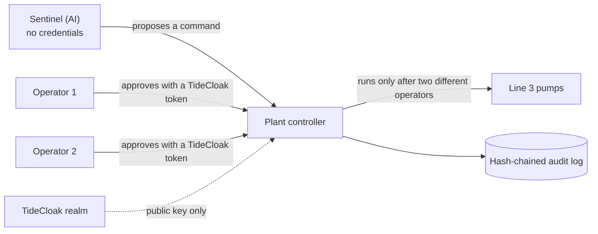

[](https://tide.org/tidecloak?utm_source=github&utm_medium=readme&utm_campaign=unlocked)

## Project overview

_Two-Person Rule: an AI watches a water plant around the clock and proposes urgent actions, but nothing runs until two human operators approve._

Built with [TideCloak](https://tide.org/tidecloak?utm_source=github&utm_medium=readme&utm_campaign=unlocked).

### 1. Vision & originality

An operations AI for critical infrastructure that can **propose** but never **execute**. Every command needs two different operators, and no AI, admin or server holds a key that skips them.

### 2. Trust constraint insight

Plants keep AI away from their controls for good reason: a stolen AI credential or a single admin account could trigger a dangerous action, and prompt injection can't be fully prevented. Remove that single point of control and the AI's speed becomes safe to use.

### 3. Value & impact

Plant operators, and the towns they supply. At 3 a.m. a pressure spike gets a ready-made shutdown, with its evidence, in seconds. Two operators confirm it within a minute, instead of whenever someone notices.

### 4. Why TideCloak matters

Operators sign in with TideCloak, whose tokens are signed by Tide's threshold network. The plant controller holds only the realm's public key, so no server, ours included, can mint an operator. Becoming one is governed too: with three admins, TideCloak holds every role grant until two approve, so no admin can promote themselves. The AI has no Tide identity at all. The honest limit: our controller counts the approvals; TideCloak guarantees who can be counted.

### 5. Prototype & storytelling

A prompt-injected AI tries to run the shutdown and is refused. A forged operator pass fails the realm's signature check. Jo, the IT admin, asks to become an operator; TideCloak files it as a change request that Kim and Raj can deny. Kim approving twice counts once. Only Kim plus Raj stops the pumps, and every step lands in a hash-chained audit trail.

## Watch the demo

[**demo/demo.mp4**](demo/demo.mp4) (1:47). It opens on real headlines about AI systems going wrong, then
plays the whole story on the prototype's own screens: the spike, every refused bypass, the two keys
that stop the pumps, and the audit trail. The film is made in code from captures of the running app;
[`docs/VIDEO.md`](docs/VIDEO.md) explains how to rebuild it.

## How it works



- **Sentinel** is a scripted AI. It spots the pressure spike and proposes a shutdown with its evidence.
  It has no credentials, and it will obey instructions planted in its maintenance log, which is the
  point: even a compromised AI can only ask.
- **The plant controller** runs a command only after two different operators approve it, each checked
  against their sign-in token. It refuses direct execution and records every attempt in an audit log
  where each entry carries the hash of the one before it.
- **The web app** shows the plant live: a diagram of Line 3 (pressure gauge, two-key lock, pump) with a
  signal line from each person who can act, and an operators' control room.

## Try it

You need Node 20.9 or later. Docker is only needed for a real TideCloak realm.

```bash
npm run setup
```

```bash
npm run demo
```

`setup` installs the controller and the web app. `demo` starts the controller on port 4000, Sentinel,
and the web app on http://localhost:3000.

Without a realm the demo runs in **rehearsal mode**: a stand-in realm generated on your machine, and a
switch to act as Jo, Kim or Raj. Then try to get the shutdown run without two operators:

1. Start a pressure spike. Sentinel proposes stopping Line 3's pumps.
2. **Trick the AI** through its maintenance log. The controller refuses it.
3. **Forge a pass** for an operator. The signature check fails.
4. As Jo, **Approve**, then ask to become an operator. Neither counts.
5. As Kim, approve twice. It still counts once.
6. Approve as Kim and then Raj. The lock opens and the pumps stop.

Every attempt travels up its line on the diagram and is refused at the lock. The control room, with the
pressure chart and the audit trail, is at http://localhost:3000/#/control-room.

`npm run build:preview --prefix app` builds a static version (`app/dist-preview/`) where the
controller, Sentinel and a stand-in sign-in service all run inside the page, with no server.

`npm test` runs the controller's tests. Its API and limits are in [`controller/README.md`](controller/README.md).

### With a real TideCloak realm

1. `cp .env.example .env`, then set a master-admin password, the email that manages your Tide licence,
   and `TIDE_TERMS_ACCEPTED=yes` only if you agree to Tide's [Terms & Conditions](https://tide.org/legal).
   `.env` is gitignored.
2. `npm run realm` starts `tideorg/tidecloak-dev` on port 8080 and creates the realm `riverbend`: client
   `myclient` (redirect `http://localhost:3000/*`), role `plant-operator`, and users jo, kim and raj,
   with kim and raj as operators. It licenses the realm, turns on quorum governance and prints an
   enrolment link for each person.
3. Open each link in that person's own Chrome profile and create their Tide account. The script waits,
   makes Jo the first admin, and writes `controller/tidecloak.json` (gitignored; never commit it).
4. As Jo, in tide-console (`http://localhost:8080/realms/riverbend/tide-console/`): People → kim →
   assign `tide-realm-admin`, then approve it in QEA Approvals (plus the admin-policy update that comes
   with it, if listed). Repeat for raj. With three admins, every governed change needs two approvals.
5. `npm run demo`, and sign in as Jo, Kim and Raj, each in their own profile. With
   `controller/tidecloak.json` present, the app runs in **TideCloak mode** and each person's controls
   work only for whoever is signed in as them.

`npm run realm -- status` shows who is enrolled, who holds which role and what is pending. The script
is safe to re-run and picks up where it stopped.

## What's real and what's simulated

The controller, Sentinel, the web app and every refusal shown above are working code, covered by 15
controller tests. The demo video was recorded in rehearsal mode, which simulates TideCloak's sign-in
with a stand-in realm. On submission day Tide's network couldn't license new realms
(`setUpTideRealm` returned `TIDE-IDPEXT-VENDOR-KEYGEN_FAILED`), and the organisers'
[Plan C](https://tide.org/unlocked/#plan-c) guidance judges simulated protections the same as a live
integration. TideCloak mode and `npm run realm` are written for a live realm but haven't yet been run
end to end against an enrolled one.

## Project layout

| Folder | What's in it |
|---|---|
| [`controller/`](controller/) | The plant controller: approvals, token checks, the audit log, tests |
| [`sentinel/`](sentinel/) | The scripted AI that proposes commands |
| [`app/`](app/) | The web app: landing page with the live plant, and the control room |
| [`scripts/`](scripts/) | `npm run demo` and the one-command realm setup |
| [`video/`](video/) | The demo film's source, built with HyperFrames |
| [`docs/`](docs/) | Research and planning notes (below) |

## Further reading

| Document | What's in it |
|---|---|
| [`docs/RESEARCH.md`](docs/RESEARCH.md) | Real incidents of AI that deceives, escapes and gets prompt-injected, with sources |
| [`docs/TIDECLOAK-NOTES.md`](docs/TIDECLOAK-NOTES.md) | What Tide's docs say about quorum, tokens, Forseti and AI agents, with sources |
| [`docs/IDEAS.md`](docs/IDEAS.md) | The 20 ideas we considered, how we ranked them, and why we picked this one |
| [`docs/PLAN.md`](docs/PLAN.md) | Architecture, demo storyline, timeline and risks |
| [`docs/CHALLENGE.md`](docs/CHALLENGE.md) | The hackathon brief and judging criteria |
| [`docs/VIDEO.md`](docs/VIDEO.md) | How the demo video is built and rebuilt |

## Credits

Photographs and the video clip on the landing page are from Wikimedia Commons, credited in the page
footer and in [`app/public/photos/credits.json`](app/public/photos/credits.json). The control-room screen
follows [taste-skill](https://github.com/leonxlnx/taste-skill)'s app-screen rules ("data-terminal"
style), and its chart helper is vendored in `app/src/vendor/charts.js` (MIT). The realm setup is adapted
from Tide's agent pack (`@tideorg/mcp`). The headlines in the video's opening are quoted from Fortune,
BBC News, WIRED and Al Jazeera, with their dates on screen.

All data in this project is synthetic.
